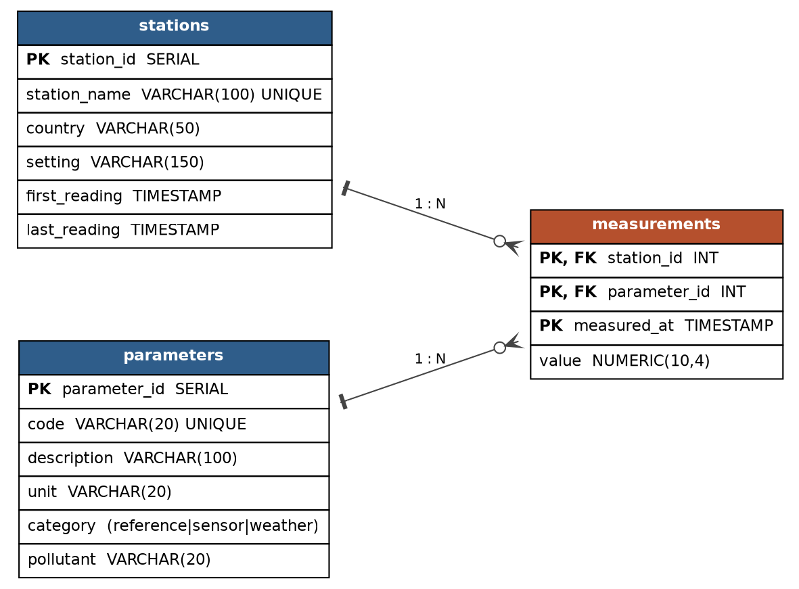

# ml_pipeline_formative1

## Task 1: Exploratory analysis and forecasting model

**Owner:** Anglebert Shumbusho Ishimwe

**Dataset:** Air Quality, UCI Machine Learning Repository (Kaggle copy). Hourly readings from 10/03/2004 to 04/04/2005, 9,357 records. Licence CC BY 4.0, DOI [10.24432/C59K5F](https://doi.org/10.24432/C59K5F).

### Files

| File | Purpose |
|---|---|
| `notebooks/data/AirQualityUCI.csv` | Raw dataset |
| `src/preprocessing.py` | Loading, cleaning and feature building, shared with Task 4 |
| `notebooks/task1_eda_and_model.ipynb` | Exploration, six analytical questions, model training and results |
| `notebooks/models/co_forecast_model.joblib` | Trained forecasting model (created by the notebook) |
| `notebooks/models/model_config.json` | Model and preprocessing settings (created by the notebook) |
| `notebooks/figures/` | Analysis figures (created by the notebook) |
| `requirements.txt` | Python packages |

### How to run

Run these steps in order from the repository root.

1. Create a virtual environment:
   ```bash
   python3 -m venv .venv
   ```
2. Activate it:
   ```bash
   source .venv/bin/activate        # macOS and Linux
   .venv\Scripts\activate           # Windows
   ```
3. Install the packages:
   ```bash
   pip install -r requirements.txt
   ```
4. Open `notebooks/task1_eda_and_model.ipynb` in VS Code and select the `.venv` Python interpreter as the kernel.
5. Click **Run All**. The notebook reads `data/AirQualityUCI.csv` from the `notebooks/` folder and saves the model to `notebooks/models/` and the figures to `notebooks/figures/`. Part C tunes several models, so it takes a few minutes.

### Results

All findings, the experiment table and the final model's test scores can be seen in the notebook outputs.

# Task 2: Database Design (SQL and MongoDB)

Dataset: **UCI Air Quality** (`AirQualityUCI.csv`), hourly readings from a multi-sensor air-quality station in an Italian city, 10 Mar 2004 to 4 Apr 2005 (9,357 rows, 13 measured variables).

## Data preparation
- The value `-200` marks a missing reading, so those values are not stored. Without this step, averages would be badly wrong.
- NMHC(GT) is about 90% missing, so treat it with care.
- Date format in the CSV is month/day/year.

## 1. Relational design (PostgreSQL)

| Table | Purpose |
|---|---|
| `stations` | One row per monitoring station |
| `parameters` | Lookup of the 13 measured variables (code, description, unit, category: reference / sensor / weather) |
| `measurements` | Fact table: one row per station, parameter and hour. PK = (`station_id`, `parameter_id`, `measured_at`); 104,940 rows |

Using a long (narrow) format means a new sensor is added as a row in `parameters`, not as a new column.

Files, run in order: `01_schema.sql`, `02_seed_stations_parameters.sql`, `03_load_postgres.py` (prepares `meas.csv`; load it with `\copy measurements FROM 'meas.csv' CSV HEADER`), `04_queries.sql`. Results: `04_results_sql.txt`.

## 2. MongoDB design
One document per hourly reading, with nested sub-documents for reference analyzers, low-cost sensors and weather. Missing values are omitted from the document. The station is embedded as a small sub-document, since there is only one station and the data is always read together with the reading. For several stations or heavy time-series use, a native time-series collection (`timeField: timestamp`, `metaField: station`) is the natural next step.

```json
{
  "timestamp": "2004-03-10T18:00:00Z",
  "station":   { "station_id": 1, "name": "Italian city air-quality station", "country": "Italy" },
  "reference": { "co_mg_m3": 2.6, "nmhc_ug_m3": 150, "benzene_ug_m3": 11.9, "nox_ppb": 166, "no2_ug_m3": 113 },
  "sensors":   { "co": 1360, "nmhc": 1046, "nox": 1056, "no2": 1692, "o3": 1268 },
  "weather":   { "temp_c": 13.6, "rh_pct": 48.9, "abs_humidity": 0.7578 }
}
```

Files: `05_mongo_load_and_queries.py` (loads data and runs the queries), `05_mongo_queries.js` (the same queries for `mongosh`), `05_results_mongo.txt`.

## Queries (same four on both databases, identical results)
1. **Date-range filter**: 11 Mar 2004, 06:00 to 10:00. CO rises from 0.7 to 2.2 mg/m3 and NO2 from 48 to 112 ug/m3 in the morning rush.
2. **Monthly averages** of CO, benzene and NO2. NO2 peaks in Feb 2005 (160.7 ug/m3) and is lowest in Aug 2004 (70.1).
3. **Top 5 days by average NO2** (days with at least 18 valid hours). The worst day is 11 Feb 2005 (223.3 ug/m3).
4. **Average CO by hour of day**. Lowest at 05:00 (0.71 mg/m3), highest at 19:00 (3.73).

The SQL version also includes a data-quality query counting missing readings per parameter.

## How to run
**MongoDB** (Atlas free tier or local):
```
pip install pymongo pandas dnspython
set MONGO_URI=<your connection string>        # PowerShell: $env:MONGO_URI="..."
python 05_mongo_load_and_queries.py
```
Put `AirQualityUCI.csv` in the same folder. Do not commit your connection string or password.

## Screenshots
See the `screenshots/` folder (Atlas collection view with 9,357 documents, query output).

# Task 3: CRUD and Time-Series Query API

A FastAPI service exposing CRUD (`POST`, `GET`, `PUT`, `DELETE`) and the two
required query endpoints (latest record, records by date range) for both
databases built in Task 2.

| Resource | Endpoints |
|---|---|
| `/sql/measurements` (PostgreSQL) | `POST`, `GET` (list), `GET /latest`, `GET /range`, `GET /{station_id}/{parameter_id}/{measured_at}`, `PUT /{station_id}/{parameter_id}/{measured_at}`, `DELETE /{station_id}/{parameter_id}/{measured_at}` |
| `/mongo/readings` (MongoDB) | `POST`, `GET` (list), `GET /latest`, `GET /range`, `GET /{id}`, `PUT /{id}`, `DELETE /{id}` |

Files: `task3_api/db.py` (connections), `task3_api/schemas.py` (request/response
models), `task3_api/sql_routes.py`, `task3_api/mongo_routes.py`, `task3_api/main.py`
(FastAPI app), `task3_api/tests/` (pytest suite).

## How to run
1. Copy `.env.example` to `.env` and fill in `DATABASE_URL` (PostgreSQL loaded
   in Task 2) and, optionally, `MONGO_URI`. If `MONGO_URI` is left empty, the
   Mongo endpoints run against the in-memory `mongomock` emulator instead of a
   real MongoDB instance.
2. `pip install -r requirements.txt`
3. `uvicorn task3_api.main:app --reload`
4. Open `http://127.0.0.1:8000/docs` for interactive Swagger docs.

## Tests
```bash
pytest task3_api/tests
```
The SQL tests fake the `psycopg2` connection (no live PostgreSQL required) to
check routing, status codes and error handling. The MongoDB tests run against
`mongomock` end to end.

## Task 4: Prediction & Inference Pipeline Integration

### Overview
The prediction pipeline (`src/predict_pipeline.py`) performs real-time inference by consuming recent air quality observations from the Task 3 FastAPI server, engineering necessary lag and cyclical features, and generating single-step forward Carbon Monoxide ($\text{CO}$) forecasts.

---

### Pipeline Workflow
1. **API Data Ingestion**: Sends a `GET` request to `http://localhost:8000/api/v1/readings/recent?limit=48` to retrieve the latest 48 time-series records.
2. **Preprocessing & Gap Handling**: Converts missing values (`-200` sentinels) to standard null values and applies time-based linear interpolation for gaps $\le 6$ hours.
3. **Feature Engineering**: Constructs feature matrices matching Task 1 model training inputs:
   - Target Lags (`co_t`, `co_lag_1`, `co_lag_2`, `co_lag_3`, `co_lag_23`)
   - Rolling Statistics (`co_ma_3`, `co_ma_6`, `co_ma_24`, `co_std_24`)
   - Auxiliary Sensors (`PT08.S1(CO)`, `NOx(GT)`, `T`, `RH`, `AH`, etc.)
   - Cyclical Features (`hour_sin`, `hour_cos`, `is_weekend`, `dayofweek`, `month`)
4. **Inference Execution**: Loads `models/co_forecast_model.joblib` (`HistGradientBoostingRegressor`) to compute the 1-hour ahead prediction.

---

### Execution Instructions

1. **Start the API Server** (Terminal 1):
   ```powershell
   python -m uvicorn task3_api.main:app --reload --port 8000